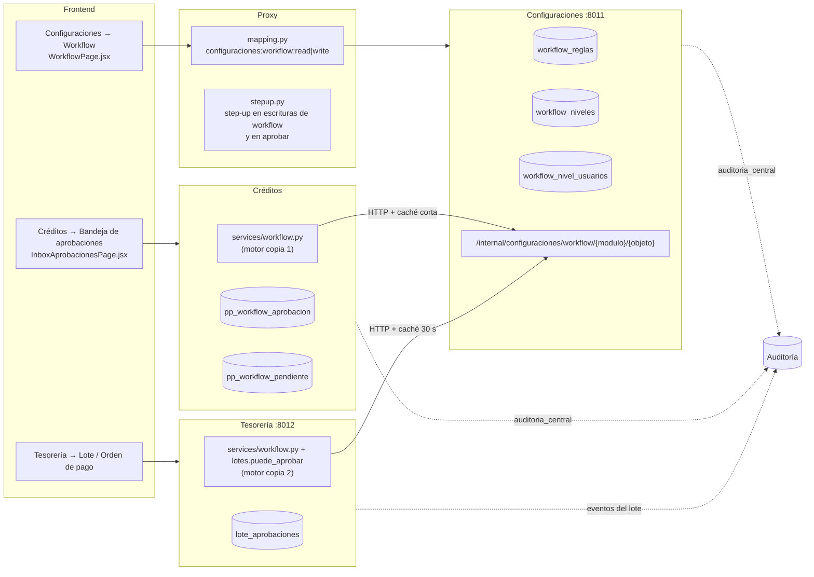
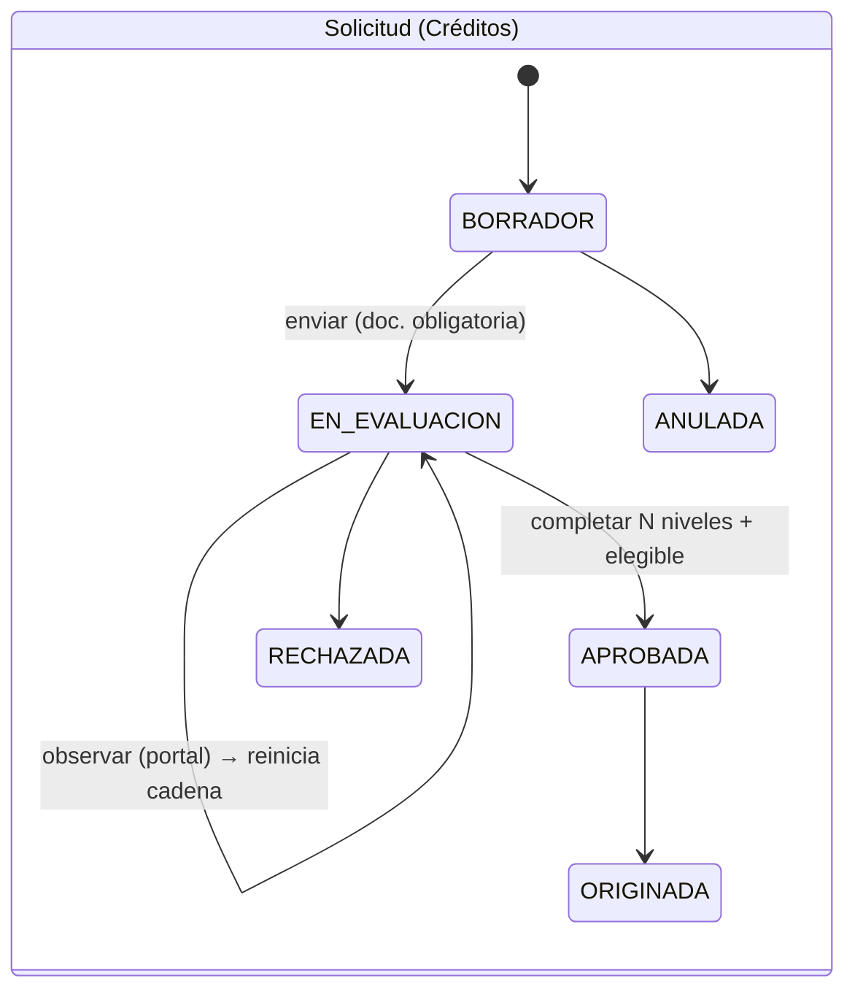
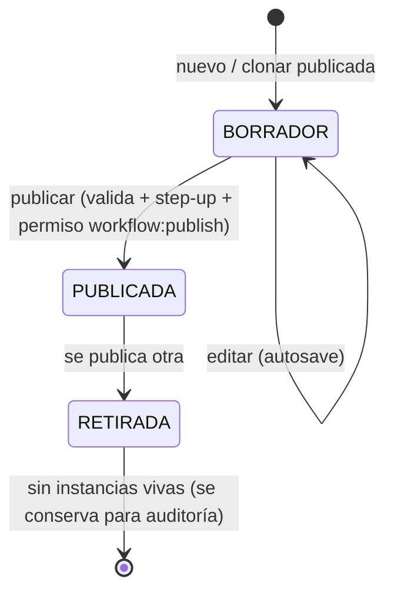
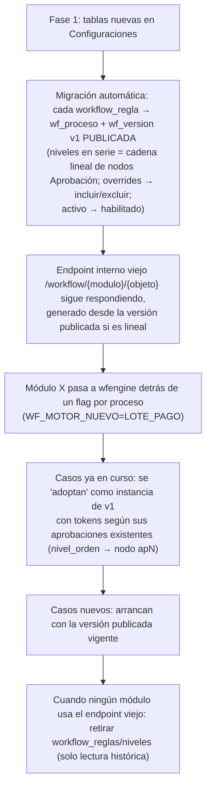
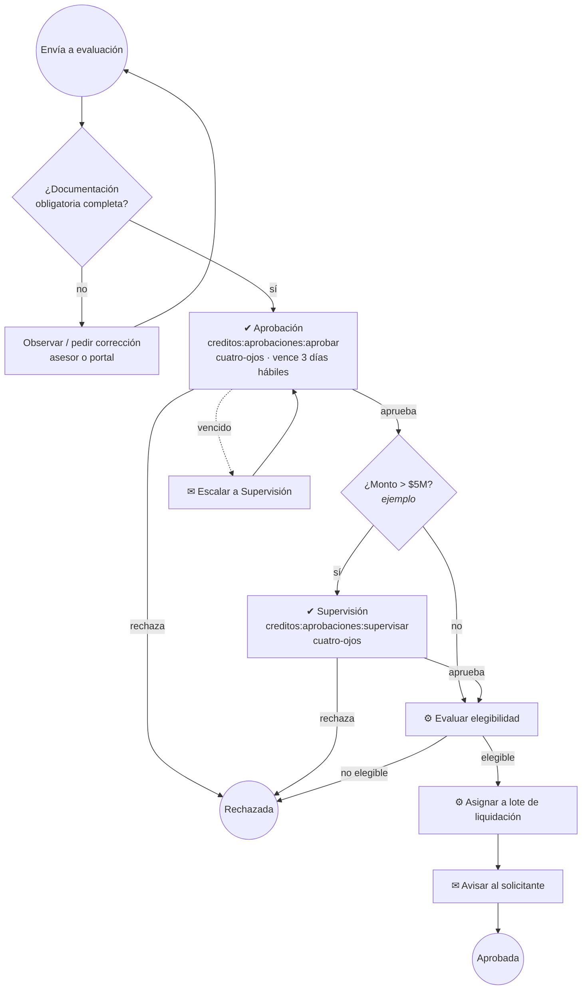

# Workflows gráficos — análisis y propuesta

> Estado: **análisis, sin implementación**. Rama `analisis-workflows`.
> Prototipo visual: [`docs/prototipo-workflows.html`](prototipo-workflows.html) (abrir en el navegador; no necesita servidor ni internet).

## Resumen

- **Qué hay hoy:** el "workflow" es en realidad una **cadena de aprobaciones en serie**: N niveles, cada uno con un rol fijo (`APROBAR` o `SUPERVISAR`), un tilde de cuatro-ojos y excepciones por usuario. La definición vive en Configuraciones y la ejecución está copiada a mano en Créditos y en Tesorería. Los estados de cada objeto (borrador, en evaluación, aprobada…) están escritos en el código de cada módulo y no son configurables.
- **Qué falta:** condiciones (por monto, línea, origen), ramas, pasos en paralelo, grupos, vencimientos, notificaciones, versionado y una vista del caso puntual ("¿en qué paso está este lote?"). Además, un cambio en una regla **afecta en el acto a las aprobaciones que ya están en curso**. Eso hoy produce dos defectos concretos (ver §2.3).
- **Propuesta:** un editor de **diagramas de nodos** (inicio, tarea, aprobación, decisión, acción automática, notificación, espera, subflujo, fin) con **versiones publicadas que no cambian**. Cada caso en curso queda atado a la versión con la que arrancó. Antes de publicar se puede **simular**, y cada caso se ve **pintado sobre el diagrama**.
- **Recomendación técnica:** usar **React Flow (`@xyflow/react`, MIT)** con auto-layout **ELK/dagre** y nuestro propio JSON de grafo, sin BPMN. Un **motor chico compartido** que corre *dentro* de cada módulo, para que la aprobación y el cambio de estado sigan en la misma transacción. La definición versionada queda en Configuraciones.
- **Esfuerzo estimado:** **~200–270 h** en 7 fases. La primera entrega útil (fases 0–4: editor, simulador y Tesorería `LOTE_PAGO` como piloto en el motor nuevo) lleva ~140–185 h. Una versión reducida que sólo dibuja las reglas actuales, sin tocar ejecución, lleva ~40–55 h.

---

## 1. Cómo funciona hoy

### 1.1 Piezas



### 1.2 Modelo de datos (Configuraciones, `modules/configuraciones/app/models.py`)

| Tabla | Qué guarda |
|---|---|
| `workflow_reglas` | una por `(modulo, objeto)` (único): nombre, descripción, `activo` |
| `workflow_niveles` | niveles en serie `orden 1..N`: nombre, `rol` (`APROBAR`/`SUPERVISAR`), `cuatro_ojos` |
| `workflow_nivel_usuarios` | override por nivel: `username` + `INCLUIR`/`EXCLUIR` |

El catálogo de "objetos aprobables" está **escrito en el código** (`app/services/workflow.py → CATALOGO`). El arranque y el `GET /workflow` siembran lo que falte:

| Módulo | Objeto | Arranca | Dónde se ejecuta |
|---|---|---|---|
| creditos | `LINEA` (publicar versión de línea) | inactiva | `api/productos.py` |
| creditos | `SOLICITUD` | inactiva | `api/solicitudes.py → cambiar_estado` |
| creditos | `DESEMBOLSO` | inactiva | `api/contratos.py → _gate_workflow` + `pp_workflow_pendiente` |
| creditos | `REFINANCIACION` | inactiva | idem |
| tesoreria | `LOTE_PAGO` | **activa** | `services/lotes.py → puede_aprobar / aprobar` |

### 1.3 API

- Pública, a través del proxy (`/api/configuraciones/workflow…`):
  - `GET ""` lista y siembra.
  - `PUT /reglas/{id}` activa, renombra.
  - `POST /reglas/{id}/niveles`.
  - `PUT|DELETE /niveles/{id}` (el borrado vuelve a numerar 1..N y no deja la regla sin niveles).
  - `POST /niveles/{id}/usuarios` y `DELETE /usuarios/{id}`.
- Interna, con clave: `GET /internal/configuraciones/workflow/{modulo}/{objeto}` y un import masivo que usó el ETL de Créditos (`etl/migrar_configuraciones.py`).

### 1.4 El "motor" (ejecución)

Hay **dos implementaciones** casi iguales:

- **Créditos** (`backend/app/services/workflow.py`):
  - `progreso()` toma `nivelActual = max(aprobados) + 1`.
  - `puede_aprobar()` controla primero el rol, que sale de los permisos `creditos:aprobaciones:*`, con los overrides aplicados (rechazo → 403), y después cuatro-ojos: no aprueba el emisor ni quien ya aprobó otro nivel (rechazo → 409).
  - `aprobar_paso()` inserta en `pp_workflow_aprobacion` con la única `(objeto, objeto_id, nivel_orden)`. La DB arbitra la carrera entre aprobadores.
  - `limpiar_aprobaciones()` reinicia la cadena al rechazar, observar o reenviar.
- **Tesorería** (`app/services/workflow.py` + `services/lotes.py`): la misma lógica, con `lote_aprobaciones` y única `(lote_id, nivel_orden)`. Si no puede leer la regla, **falla cerrado** con 503. Cada paso deja un evento en la bitácora del lote.
- **Regla inactiva o inexistente:** no hay cadena y alcanza con el permiso de aprobar de la pantalla (H-141/H-153: con un único admin el sistema no se traba).

### 1.5 Estados: siguen en el código

El workflow configurable **sólo cubre la compuerta de aprobación**. Los ciclos de vida están cableados en cada módulo:



| Objeto | Ciclo (en código) |
|---|---|
| Lote de liquidación (Créditos) | `ABIERTO → CERRADO → CON_RESOLUCION` (Despacho) `→ PARA_LIQUIDAR` (OP de Tesorería) `→ LIQUIDADO` |
| Lote de pagos (Tesorería) | `PENDIENTE_APROBACION → APROBADO → ENVIADO → CONFIRMADO / CON_ERRORES`, o `→ RECHAZADO` |
| Pago (Tesorería) | `PENDIENTE → ENVIANDO → ENVIADO → CONFIRMADO / FALLIDO / INCIERTO`, o `EXCLUIDO` |
| Resolución (Despacho) | `BORRADOR (B) → FIRMADA (F)`, anulada / inactiva. **Sin workflow** |
| Autorización (Cajeros) | `PENDING → APPROVED / REJECTED / EXPIRED`, con su propio modelo `authorization_rules` (autorizador por cajero, moneda y **tope de monto**). **No usa el workflow de Configuraciones** |

### 1.6 Integraciones transversales

- **Permisos** (`security/app/seed.py` y `proxy/app/routes/mapping.py`):
  - `configuraciones:workflow:read|write` para ver o editar la definición. Es un permiso aparte del de operar el módulo, para que quien carga créditos no se saque de encima su propio control.
  - `<modulo>:aprobaciones:aprobar|supervisar` son los "roles" de cada nivel.
  - Los permisos efectivos incluyen los **grupos** de usuarios, pero el workflow **no puede apuntar a un grupo**: sólo a uno de los dos roles o a usernames sueltos.
- **Step-up (2FA)** (`proxy/app/routes/stepup.py`):
  - Toda escritura en `/api/configuraciones/workflow` pide step-up.
  - También lo piden aprobar en Créditos (`/aprobaciones/pendientes/…/aprobar`) y aprobar o enviar lotes de Tesorería.
- **Auditoría:** `auditoria_central.py` (vendorizado en cada módulo) manda fila por fila lo que cambió y lo cruza con la request del gateway por `X-Request-Id`. Queda registro de *qué fila cambió*, pero **no hay una noción de "versión de la regla"** ni un diff legible del tipo "se agregó el nivel Gerencia".
- **Outbox:** no participa. El único outbox es el del módulo Legacy. Las llamadas Créditos → Tesorería → Créditos son HTTP internas.
- **Notificaciones:** existe el módulo `notifications` (`POST /internal/notifications`), pero **el workflow no avisa a nadie**. El aprobador se entera cuando entra a su bandeja.

### 1.7 Frontend actual

`WorkflowPage.jsx` (222 líneas) tiene 8 tests en `WorkflowPage.test.jsx` (agrupar, activar, desactivar, nivel, error en modal, quitar, excepciones, sólo lectura). Muestra:

- una tarjeta por regla, con una lista numerada de niveles;
- modales para nivel y excepción;
- `Confirmacion` para activar, desactivar o quitar.

Es claro para lo que modela, pero lo que modela es una lista.

---

## 2. Limitaciones y problemas

### 2.1 Expresividad

1. **Sólo serie.** No se puede decir "si el monto supera $X, además Gerencia", ni "Legales y Contaduría en paralelo", ni "si viene del portal, primero verificar documentación".
2. **Sólo dos roles fijos** (`ROLES = ("APROBAR","SUPERVISAR")`). No se puede asignar un nivel a un **grupo** ni a un permiso específico (p.ej. "Gerencia de Créditos").
3. **No hay rechazo configurable:** rechazar siempre reinicia la cadena entera. No existe "devolver al nivel anterior" ni "pedir corrección".
4. **Sin tiempos:** no hay vencimientos, recordatorios ni escalamiento. Cajeros tiene `EXPIRED` por su lado.
5. **Sin acciones ni avisos:** no se puede "notificar al solicitante" ni "pasar a Tesorería" desde el flujo. Eso está en el código.
6. **El ciclo de vida no es visible ni configurable**, y el circuito completo (Solicitud → Lote → Resolución → OP → Lote de pagos → acreditación) no está dibujado en ningún lado.

### 2.2 Modelo de datos y mantenimiento

- **El catálogo de objetos está en código** (`CATALOGO`): sumar un objeto requiere deploy de Configuraciones y del módulo.
- **El motor está duplicado** en Créditos y Tesorería, y ya divergen. Por ejemplo, con un nivel inexistente Créditos permite aprobar y Tesorería da 409. Despacho y Cajeros tendrían que hacer una tercera y una cuarta copia.
- **Los overrides se cargan como texto libre** (`username`): no se valida contra Seguridad y un error de tipeo pasa inadvertido.
- **No hay historia de la definición:** no se sabe qué regla regía cuando se aprobó el lote 123.
- **No hay bandeja unificada:** Créditos tiene `/aprobaciones/inbox`, Tesorería la suya, y Cajeros y Despacho nada.

### 2.3 Defectos concretos por no versionar (leídos del código, sin reproducir todavía)

La regla se lee "en vivo" (caché de 30 s) y el progreso de un caso se calcula contra la regla **actual**:

- **Créditos: un nivel desaparecido se aprueba sin control de rol.**
  - Escenario: una regla de 3 niveles con el nivel 1 aprobado. Alguien la baja a 1 nivel.
  - `nivelActual = 2`, que no existe, y `puede_aprobar()` devuelve `True, "sin nivel"` **sin chequear rol ni cuatro-ojos** (`creditos/backend/app/services/workflow.py`, último bloque).
  - Resultado: cualquier usuario que llegue a ese endpoint completa la cadena. El emisor de la solicitud también, si tiene acceso a la pantalla.
- **Tesorería: el lote queda trabado.**
  - Escenario: lote con 2 niveles aprobados en una regla de 3, que se baja a 2.
  - `puede_aprobar()` responde 409 "La aprobación ya está completa", pero el lote nunca pasó a `APROBADO`, porque eso sólo se evalúa al aprobar. El lote queda en `PENDIENTE_APROBACION` sin salida, salvo modificarlo para que se reinicien las aprobaciones.
- **Al revés:** si se **agrega** un nivel, los casos en curso de golpe necesitan una aprobación más.

> Sugerencia independiente del rediseño: abrir dos hallazgos con test de regresión. Los dos se corrigen en pocas líneas: en Créditos, `sin nivel` → 409 o "completa"; en Tesorería, recalcular el cierre. El rediseño los elimina de raíz con el versionado.

### 2.4 UX

- Una lista numerada no muestra **ramas, condiciones ni consecuencias**. Hay que leer la descripción y suponer.
- **Activar o desactivar** una regla tiene efecto inmediato y global: no hay borrador ni "probar antes".
- No hay forma de ver **dónde está un caso puntual**. Se pregunta en el chat, o se mira el historial del lote o las aprobaciones de la solicitud.

---

## 3. Propuesta funcional

### 3.1 Conceptos

| Concepto | Qué es |
|---|---|
| **Proceso** (`wf_proceso`) | Qué se gobierna: `(modulo, objeto)`. Ejemplos: `tesoreria/LOTE_PAGO`, `creditos/SOLICITUD`. Reemplaza a `workflow_reglas`. Lo **declara cada módulo** (ver §4.4), con sus *variables* (monto, línea, origen…), *acciones* y *eventos* disponibles. |
| **Versión** (`wf_version`) | Un grafo. Estados: `BORRADOR → PUBLICADA → RETIRADA`. **Una sola publicada vigente** por proceso. Una versión publicada **no se edita nunca**: se clona en un borrador nuevo. |
| **Instancia** (`wf_instancia`) | Un caso concreto (el lote 123). Queda **atada a la versión con la que arrancó** hasta terminar. |
| **Tarea** (`wf_tarea`) | Trabajo humano pendiente en un nodo (aprobar, completar). Alimenta la bandeja. |

### 3.2 Tipos de nodo

| Nodo | Forma | Propiedades | Semántica |
|---|---|---|---|
| **Inicio** | círculo verde | evento disparador (`creado`, `enviado`…) | exactamente uno |
| **Tarea / estado** | rectángulo | nombre, estado de negocio que fija (`EN_EVALUACION`), quién la completa, formulario o pantalla destino | espera que alguien haga algo en el módulo |
| **Aprobación** | rectángulo con ✔ | asignado a: **rol, permiso o grupo** de Seguridad, más incluir/excluir usuarios (elegidos de una lista, no tipeados); **cuatro-ojos**; quórum (1 de N, todos, N de M); salidas `aprobado` / `rechazado` / `devuelto` | reemplaza al "nivel" |
| **Decisión** | rombo | una salida por condición, más una salida **por defecto** obligatoria | ramas excluyentes; se evalúan en orden |
| **Paralelo (bifurca / une)** | barra | — | todas las ramas en paralelo y se espera a todas. Ejemplo: Legales ‖ Contaduría |
| **Acción automática** | rectángulo con ⚙ | acción del **catálogo del módulo** (`evaluar_elegibilidad`, `asignar_a_lote`, `enviar_a_tesoreria`…) + parámetros | la ejecuta el módulo; tiene salidas `ok` / `error` |
| **Notificación** | sobre ✉ | destinatarios (rol, grupo, iniciador, asignados de un nodo), plantilla | usa el módulo `notifications`; no bloquea |
| **Espera / temporizador** | reloj | duración o fecha (días hábiles con los **feriados** de Configuraciones), o "hasta evento X" | también como **vencimiento** de una aprobación (salida `vencido` → escalar o rechazar) |
| **Subflujo** | rectángulo doble | proceso y versión a invocar | reutiliza circuitos (p.ej. "Firma de resolución" de Despacho) |
| **Fin** | círculo rojo | resultado (`APROBADO`, `RECHAZADO`, `ANULADO`) | puede haber varios |

**Conexiones:** dirigidas, con **etiqueta** y, si salen de una decisión, con una **condición**. Las condiciones se arman con un *constructor visual* (`variable · operador · valor`, combinables con Y/O) y se guardan como **JSON Logic** o un AST propio. Nunca como código libre: es seguro, se valida y se puede simular.

### 3.3 Validaciones del grafo (al guardar y, obligatorias, al publicar)

1. **Exactamente un Inicio** y **al menos un Fin**.
2. **Nada huérfano:** todo nodo alcanzable desde Inicio y con camino a algún Fin (BFS hacia adelante y hacia atrás).
3. **Decisiones completas:** ≥ 2 salidas, una "por defecto", condiciones que referencian variables existentes del proceso y con tipos compatibles (monto numérico, etc.).
4. **Aprobación bien formada:** con asignación; con al menos la salida `aprobado`. Si tiene `rechazado`, ese camino tiene que terminar.
5. **Ciclos permitidos sólo si pasan por un nodo humano o un temporizador** (para "devolver para corregir"). Un ciclo puramente automático es error.
6. **Paralelos balanceados:** cada bifurcación con su unión.
7. **Acciones y eventos** existentes en el catálogo del módulo, en la versión que declara el módulo desplegado.
8. **Asignados resolubles:** el rol, grupo o usuario existe en Seguridad. Advertencia si hoy **nadie** puede aprobar ese nodo, o si un solo usuario cubre todos los niveles con cuatro-ojos (bloqueo seguro).
9. **Subflujos** sin recursión y apuntando a versiones publicadas.

Errores y advertencias se muestran **sobre el nodo** (borde rojo o ámbar) y en un panel lateral clickeable.

### 3.4 Versionado y convivencia con casos en curso



- Las **instancias nuevas** toman la versión publicada vigente al **arrancar**.
- Las **instancias vivas siguen con su versión** hasta terminar. Esto elimina los defectos de §2.3.
- **Migración opcional y explícita** de instancias vivas a la nueva versión, caso por caso o en masa, con un mapeo nodo viejo → nodo nuevo. Fase posterior; de entrada no se ofrece.
- **Activar o desactivar** pasa a ser una propiedad del proceso: "sin workflow" equivale al comportamiento de hoy con la regla inactiva. Esto respeta H-141 (single-admin).
- **Comparar versiones:** vista con los nodos agregados, quitados o modificados resaltados.

### 3.5 Simulación antes de publicar

Panel "Probar" sobre el borrador:

1. Cargar **variables de ejemplo** (monto 3.500.000, origen PORTAL, línea…) o **tomarlas de un caso real**, sólo lectura.
2. Elegir "**actuar como**" un usuario o rol: el simulador marca qué nodos podría aprobar (rol, grupo, overrides, cuatro-ojos).
3. Avanzar paso a paso (aprobar, rechazar, vencer el temporizador) o "correr hasta el final". El camino recorrido **se pinta en el diagrama**.
4. **Escenarios guardados** por versión (p.ej. "monto bajo", "monto alto", "rechazo en gerencia"), que se re-ejecutan al publicar como test de regresión.

Las acciones automáticas y las notificaciones **no se ejecutan** en simulación: se muestran como "se ejecutaría `asignar_a_lote`".

### 3.6 Caso en curso pintado sobre el diagrama

Desde el lote, la solicitud o la resolución, un botón **"Ver circuito"** abre el diagrama de **su versión** con:

- **verde** = completado, con quién y cuándo en un tooltip;
- **azul pulsante** = actual, con quiénes pueden actuar y desde cuándo;
- **gris** = no recorrido;
- **ámbar** = por vencer;
- **rojo** = error de acción automática.

Al costado, la línea de tiempo de eventos. Es la misma vista que el simulador, así que se construye una sola vez.

### 3.7 Permisos, step-up y auditoría

| Permiso | Para qué |
|---|---|
| `configuraciones:workflow:read` | ver procesos, versiones, diagramas (ya existe) |
| `configuraciones:workflow:write` | editar **borradores** y simular (ya existe) |
| `configuraciones:workflow:publish` | **nuevo**: publicar, retirar, activar o desactivar un proceso, migrar instancias |
| `<modulo>:workflow:ver-circuito` (opcional) | ver el diagrama de un caso. Alternativa: usar el `read` del módulo |

- **Step-up:** obligatorio para `publish` (y lo que hoy ya lo pide). Recomendación: **no** pedirlo en cada autosave del borrador, porque un borrador no rige nada. Hay que ajustar `stepup.py` para que excluya `PUT /workflow/versiones/{id}/grafo` en estado borrador, o mover el autosave a una ruta sin step-up.
- **Cuatro-ojos sobre el propio workflow** (opcional, recomendado para `LOTE_PAGO`): quien editó el borrador no puede publicarlo. Es el mismo principio que ya se aplica a créditos.
- **Auditoría:**
  - Cada versión guarda `creada_por`, `publicada_por`, `publicada_en`, un hash del grafo y un **diff semántico** respecto de la anterior ("+ nodo Aprobación Gerencia; condición monto > 5.000.000").
  - `auditoria_central` sigue registrando las filas; además se emite un evento de negocio `WORKFLOW_PUBLICADO`.
  - Cada instancia registra `wf_evento` (nodo, acción, actor, timestamp, request_id).

---

## 4. Opciones técnicas

### 4.1 Editor gráfico

| Opción | Licencia | Pros | Contras |
|---|---|---|---|
| **React Flow (`@xyflow/react`)** | **MIT** (hay "Pro" pago sólo para ejemplos y soporte; no hace falta) | Nativo React 18 (el front ya lo es). Los nodos son **componentes JSX con Tailwind**, así que respetan el tema claro/oscuro (H-208). Zoom, pan, minimapa, selección, conexión por arrastre, undo vía estado. Muy usado y mantenido. Probable con Vitest + jsdom (con `ResizeObserver` mockeado) | No trae auto-layout (se suma **elkjs**, EPL-2.0, o **dagre**, MIT). La semántica (validación, tipos) la escribimos nosotros. Bundle ~150 KB gz con ELK (lazy-load de la pantalla) |
| **bpmn-js** (bpmn.io / Camunda) | Licencia bpmn.io: uso libre, pero **obliga a dejar visible el logo/watermark de bpmn.io** | Estándar BPMN 2.0 completo; editor maduro; exporta XML | BPMN es **más difícil de leer** para usuarios no técnicos (lo contrario de lo que se pide). Es un mundo aparte de React/Tailwind, cuesta tematizarlo y adaptarle el modo oscuro. Para aprovecharlo de verdad haría falta un motor BPMN (Camunda/Flowable = JVM, otro servicio, otra ops). Sobredimensionado |
| **JointJS** (core) / JointJS+ | core MPL-2.0; **+ comercial** (~USD 3k/dev) | Muy potente | Lo útil (inspector, stencil, layout) está en la versión paga |
| **GoJS** | **comercial** | Excelente para diagramas | Pago; no es React-first |
| **Rete.js** | MIT | Editor de nodos | Orientado a *dataflow* (puertos tipados), no a procesos; comunidad más chica |
| **Drawflow** | MIT | Liviano, sin dependencias | Vanilla JS, poco mantenido, sin layout |
| **Mermaid** (sólo lectura) | MIT | Ideal para **documentar** | No es editor |

**Recomendación: React Flow + elkjs**, con **JSON de grafo propio** (no BPMN):

- encaja con el stack y con los principios de UI (componentes, tema, `Modal`, `Pill`);
- es gratis y MIT;
- permite nodos tan simples como se quiera: una tarjeta con ícono, título y "quién aprueba";
- se puede exportar a Mermaid o a PNG para documentación, y en el futuro, si hiciera falta, **exportar** a BPMN (el modelo es un subconjunto).

### 4.2 Dónde corre el motor

| Alternativa | Pros | Contras |
|---|---|---|
| **A. Servicio central de workflow** (Configuraciones o módulo nuevo) que guarda instancias y ejecuta | Bandeja y vista unificadas trivialmente; una sola implementación | El cambio de estado del objeto (lote → APROBADO) queda **en otra DB**: se pierde la atomicidad que hoy da "la DB del módulo es el árbitro". Necesita saga u outbox en ambos sentidos. Configuraciones pasa a ser crítica en el camino de cada operación |
| **B. Motor embebido (librería) en cada módulo** + definición central versionada | **Conserva la atomicidad actual**: tarea, aprobación y estado de negocio en la misma transacción, con la constraint única como árbitro (principio de Créditos). La versión publicada es **inmutable**, así que se puede cachear para siempre por `(proceso, version)`; el fallo de Configuraciones sólo afecta al *arranque* de instancias nuevas | Hay que distribuir la librería (hoy cada imagen Docker se arma con su propia carpeta de contexto). La bandeja unificada necesita que los módulos **publiquen** sus tareas |
| **C. Motor externo** (Temporal, Camunda, n8n) | Robusto, con temporizadores y reintentos | Otro servicio con ops, JVM o cluster, costo y curva. Excesivo para el volumen |

**Recomendación: B.**

- Paquete Python `wfengine` (puro, sin I/O: `avanzar(grafo, estado, evento, contexto) → (nuevo_estado, efectos)`), con tests de propiedades.
- Tablas `wf_instancia`, `wf_token`, `wf_tarea` y `wf_evento` **en la DB de cada módulo**. Los efectos (acciones, notificaciones) los ejecuta el módulo después del commit, con reintentos.
- Distribución: igual que `auditoria_central.py` hoy, **vendorizado** con un script de sincronización y un test que compara el hash. Más prolijo: llevar el `context` de Docker a la raíz y `COPY libs/wfengine`.
- Para la bandeja unificada y la vista global, los módulos exponen `/internal/<modulo>/workflow/tareas?usuario=…` y el frontend o el proxy las agrega. Más adelante pueden empujar eventos a Configuraciones.

### 4.3 Modelo de datos propuesto

**Configuraciones** (definición):

```text
wf_proceso      id, modulo, objeto, nombre, descripcion, habilitado(bool),
                declaracion_json (variables/acciones/eventos que publica el módulo), creado_en
                UNIQUE(modulo, objeto)
wf_version      id, proceso_id, numero, estado(BORRADOR|PUBLICADA|RETIRADA),
                grafo_json, layout_json, hash, diff_resumen,
                creada_por, creada_en, publicada_por, publicada_en, retirada_en
                UNIQUE(proceso_id, numero); índice parcial único: 1 PUBLICADA por proceso
wf_escenario    id, version_id, nombre, variables_json, pasos_json, esperado_json
```

**Cada módulo** (ejecución):

```text
wf_instancia    id, proceso (modulo/objeto), version_numero, objeto_id, estado(ACTIVA|TERMINADA|CANCELADA),
                resultado, variables_json, iniciada_por, iniciada_en, terminada_en
                UNIQUE(objeto, objeto_id) WHERE estado='ACTIVA'
wf_token        id, instancia_id, nodo_id, estado, desde, vence_en        (paralelos = varios tokens)
wf_tarea        id, instancia_id, nodo_id, asignacion_json, estado, resuelta_por, resultado, fecha
                UNIQUE(instancia_id, nodo_id, ronda)   ← la DB sigue siendo el árbitro
wf_evento       id, instancia_id, nodo_id, tipo, actor, datos_json, request_id, fecha
```

**JSON del grafo** (ejemplo abreviado):

```json
{
  "schema": 1,
  "variables": { "monto": "decimal", "origen": "enum:PORTAL|SUCURSAL" },
  "nodos": [
    { "id": "inicio", "tipo": "inicio", "evento": "enviado" },
    { "id": "ap1", "tipo": "aprobacion", "nombre": "Aprobación", "asignar": { "permiso": "creditos:aprobaciones:aprobar" },
      "cuatroOjos": true, "quorum": 1, "vence": { "diasHabiles": 3, "salida": "vencido" } },
    { "id": "d_monto", "tipo": "decision", "nombre": "¿Monto alto?" },
    { "id": "sup", "tipo": "aprobacion", "nombre": "Gerencia", "asignar": { "grupo": "Gerencia Créditos" }, "cuatroOjos": true },
    { "id": "eval", "tipo": "accion", "accion": "evaluar_elegibilidad" },
    { "id": "fin_ok", "tipo": "fin", "resultado": "APROBADO" },
    { "id": "fin_rech", "tipo": "fin", "resultado": "RECHAZADO" }
  ],
  "conexiones": [
    { "de": "inicio", "a": "ap1" },
    { "de": "ap1", "a": "d_monto", "salida": "aprobado" },
    { "de": "ap1", "a": "fin_rech", "salida": "rechazado" },
    { "de": "d_monto", "a": "sup", "cond": { ">": [{ "var": "monto" }, 5000000] }, "etiqueta": "> $5M" },
    { "de": "d_monto", "a": "eval", "default": true, "etiqueta": "si no" },
    { "de": "sup", "a": "eval", "salida": "aprobado" },
    { "de": "sup", "a": "fin_rech", "salida": "rechazado" },
    { "de": "eval", "a": "fin_ok", "salida": "ok" },
    { "de": "eval", "a": "fin_rech", "salida": "error" }
  ]
}
```

La posición de los nodos va aparte (`layout_json`), para que mover una caja no genere una "nueva versión" semántica.

### 4.4 Catálogo declarado por cada módulo

Cada módulo expone `GET /internal/<modulo>/workflow/declaracion` con:

- procesos;
- variables y su tipo;
- eventos que dispara (`enviado`, `modificado`…);
- acciones automáticas que sabe ejecutar, con sus parámetros;
- estados de negocio válidos.

Configuraciones lo consume para armar la paleta, validar y simular. Así **sumar un proceso no requiere tocar Configuraciones**: se termina el `CATALOGO` en código.

### 4.5 Convivencia y migración (sin cortar flujos en curso)



- La migración v1 es **mecánica y verificable**: un test compara, para cada regla, que el motor viejo y el nuevo den la misma respuesta de `puede_aprobar` para una matriz usuarios × nivel × actores.
- **"Adoptar" los casos en curso:**
  - un lote en `PENDIENTE_APROBACION` con 1 de 2 niveles aprobados queda como instancia de v1 con el token en `ap2`;
  - las filas de `lote_aprobaciones` y `pp_workflow_aprobacion` se conservan y se copian como `wf_evento` para la historia.
- **Orden sugerido: Tesorería `LOTE_PAGO` primero.** Es una sola regla, ya activa, con motor y bitácora prolijos, y es la que más importa controlar (sale plata). Después Créditos (`SOLICITUD`, `LINEA`, `DESEMBOLSO`, `REFINANCIACION`), y después Despacho y Cajeros.
- **Créditos:** los estados de negocio siguen en el código al principio. El workflow gobierna **la compuerta de aprobación** (igual que hoy, pero con condiciones, grupos y versiones). Mover el ciclo de vida completo al grafo es una fase posterior y opcional, y **no** se recomienda para los procesos con dinero de por medio sin antes tener confianza en el motor.

---

## 5. Plan por fases

| Fase | Contenido | Horas |
|---|---|---|
| **0. Definiciones** | Responder las preguntas de §6; cerrar el JSON del grafo y los tipos de nodo de la v1; diseño visual de nodos (Figma o el HTML de este PR) | 8–12 |
| **1. Definición versionada (backend)** | Tablas `wf_proceso`/`wf_version`; validador de grafo (§3.3) con tests; API borrador/clonar/publicar/retirar/comparar; permiso `workflow:publish` + step-up; auditoría semántica; migración automática de las reglas actuales a v1; endpoint interno viejo derivado | 28–36 |
| **2. Editor gráfico** | Pantalla nueva con React Flow + ELK (lazy). Paleta de nodos, panel de propiedades con selectores de rol, grupo y usuario (de Seguridad), constructor de condiciones, validación en vivo sobre los nodos, autosave de borrador, sólo lectura, comparación entre versiones, export PNG/Mermaid. Tests Vitest. La pantalla vieja queda como "vista lista" hasta el final | 44–60 |
| **3. Motor `wfengine` + piloto Tesorería** | Librería pura con tests de propiedades (aprobación, decisión, paralelo, fin); tablas de instancia en Tesorería; adopción de lotes en curso; flag por proceso; test de equivalencia con el motor viejo; bitácora del lote alimentada por `wf_evento`; QA contra Postgres (carreras) | 36–48 |
| **4. Simulador + "Ver circuito"** | Simulación con variables y "actuar como", escenarios guardados que corren al publicar, vista de instancia pintada (en Tesorería, y genérica) | 22–30 |
| **5. Créditos** | Cuatro procesos a `wfengine` (Solicitud, Línea, Desembolso, Refinanciación), con adopción de casos vivos, bandeja de aprobaciones leyendo `wf_tarea`, regresión de H-141/H-153 (single-admin) y cuatro-ojos | 30–40 |
| **6. Nodos avanzados** | Temporizador y vencimiento con días hábiles (feriados de Configuraciones; APScheduler como en Conciliación), notificaciones (módulo `notifications`), acciones automáticas con reintento, subflujo, quórum N de M, bandeja unificada entre módulos | 32–44 |
| **7. Despacho y Cajeros** (opcional) | Circuito de firma de resoluciones; migrar `authorization_rules` de Cajeros (tope por monto = decisión + aprobación) | 20–28 |
| | **Total** | **~220–298** (sin la fase 7: **~200–270**) |

Primer hito mostrable con valor real: **fases 0–4 (~140–185 h)**, con Tesorería en el motor nuevo, editor y simulador. Si se quiere ver antes, una **versión reducida de las fases 1 + 2 que sólo dibuja las reglas actuales**, en sólo lectura (~40–55 h), ya da la visualización sin tocar ejecución.

Las estimaciones son para una persona con el contexto del repo, e incluyen tests y QA contra Postgres. No incluyen deploys ni capacitación.

### Riesgos

| Riesgo | Mitigación |
|---|---|
| **Romper aprobaciones de dinero en curso** al migrar | Flag por proceso, adopción + test de equivalencia, piloto en dev con copia de prod, rollback = apagar el flag (las tablas viejas no se tocan hasta el final) |
| **Usuarios arman flujos imposibles** (nadie puede aprobar) | Validación de asignados resolubles + advertencias + simulador + escenarios obligatorios al publicar |
| **Que la herramienta se vuelva un "BPM" difícil** | Arrancar con 5 tipos de nodo (inicio, aprobación, decisión, notificación, fin) y sumar los demás cuando haya un caso real |
| **Distribuir la librería en imágenes Docker separadas** | Vendorizado + test de hash (como `auditoria_central.py`), o mover el contexto de build a la raíz |
| **Bundle del front** | Pantalla lazy-loaded; ELK en web worker |
| **Testear el canvas en jsdom** | Separar la lógica (validación, transformación) en funciones puras testeadas; probar los paneles, no el arrastre; QA visual manual y con navegador |
| **Step-up en cada autosave** molesta | Autosave del borrador sin step-up; step-up sólo al publicar |
| **Single-admin en prod** (sólo `admin`) | Mantener "proceso deshabilitado = comportamiento de hoy" y la advertencia de bloqueo por cuatro-ojos |

---

## 6. Preguntas abiertas para Cristian

1. **Alcance:** ¿el workflow nuevo gobierna sólo **aprobaciones** (como hoy, pero gráficas, con condiciones y versionadas) o también el **ciclo de vida completo** de los objetos (estados, acciones automáticas entre módulos)? La propuesta asume aprobaciones primero y ciclo de vida después.
2. **Quién diseña:** ¿lo van a editar usuarios funcionales (Gerencia, Tesorería) o sólo administradores/sistemas? Eso define cuánto "guiar" en el editor y si hace falta cuatro-ojos para publicar.
3. **Casos reales de condición:** ¿hay hoy reglas tipo "si el monto supera $X, firma el Gerente"? ¿Cuáles umbrales, y por qué variables (monto, línea, origen portal/sucursal, sucursal)?
4. **Grupos:** ¿los aprobadores se asignan por **grupo de Seguridad** (p.ej. "Gerencia Créditos") o siguen alcanzando los dos roles APROBAR/SUPERVISAR?
5. **Vencimientos:** ¿hay plazos que se quieran controlar (p.ej. "el lote de pagos no puede estar más de 2 días hábiles sin aprobar")? ¿Qué pasa al vencer: aviso, escalar, rechazar?
6. **Notificaciones:** ¿alcanza con la campanita interna (`notifications`) o también se quiere mail o WhatsApp (Comunicación)?
7. **Rechazo:** ¿rechazar siempre vuelve al inicio, o se quiere "devolver al nivel anterior" o "pedir corrección"?
8. **Despacho y Cajeros:** ¿entran en el alcance? Cajeros ya tiene su propio esquema de autorización por monto, y Despacho no tiene aprobación hoy.
9. **Migración de casos en curso a una versión nueva:** ¿hace falta, o alcanza con que terminen con la versión vieja?
10. **Defectos de §2.3:** ¿los corregimos ya como hallazgos aparte (pocas líneas + test de regresión) sin esperar al rediseño?

---

## Anexo: ejemplo real en el diagrama nuevo (Solicitud de crédito)

Así se vería la regla `creditos/SOLICITUD` combinando lo que hoy está en código (documentación, evaluación, asignación a lote) con un umbral **de ejemplo** por monto. El umbral es ilustrativo, no está configurado hoy. El prototipo HTML dibuja este mismo flujo de forma interactiva.


